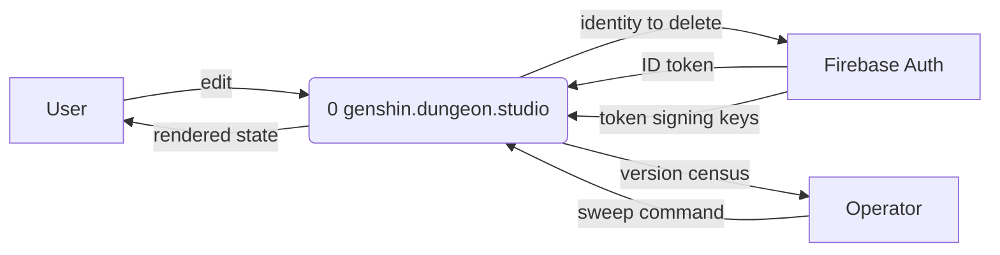
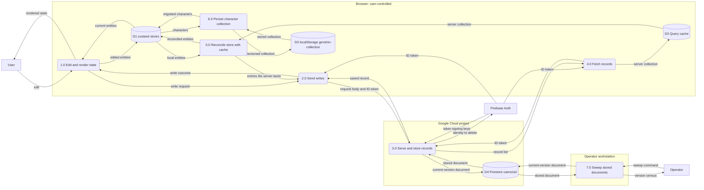
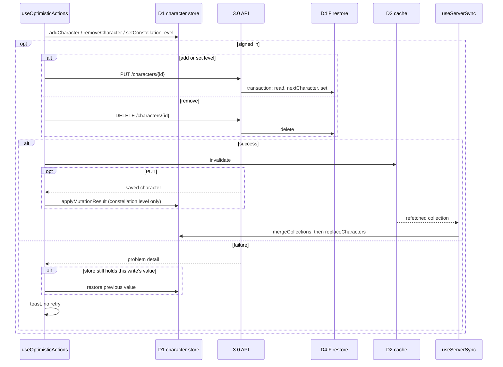
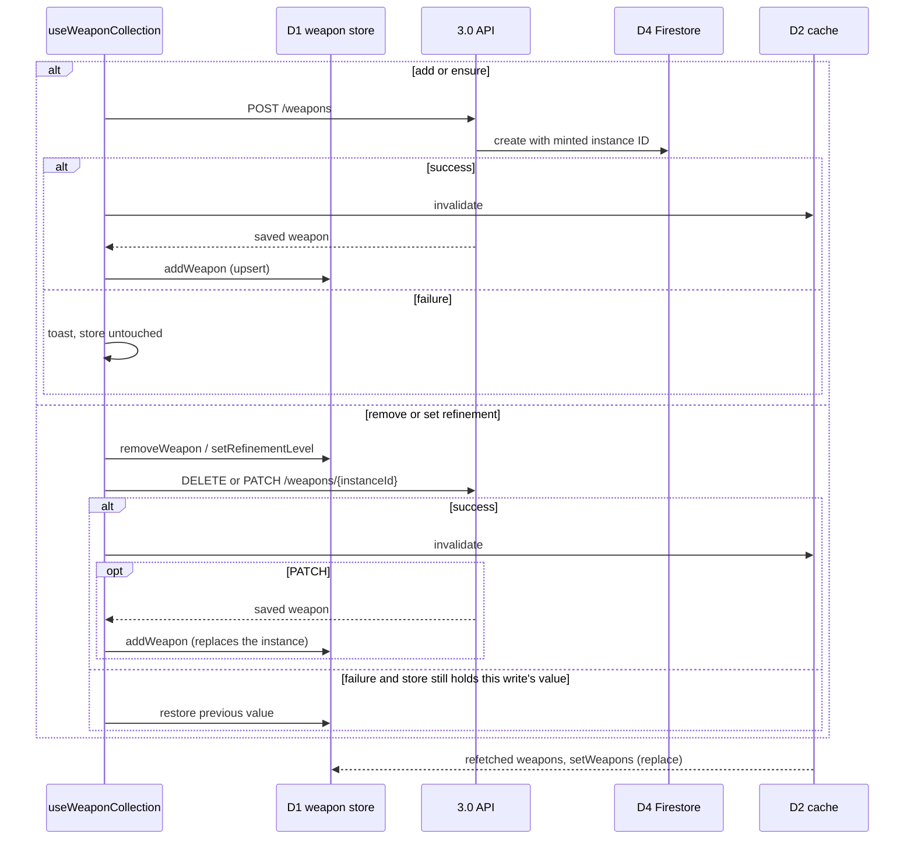
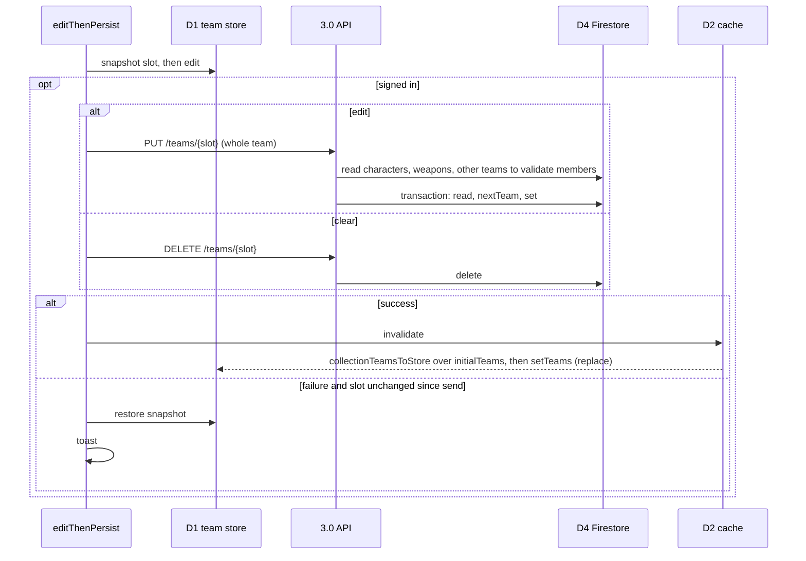
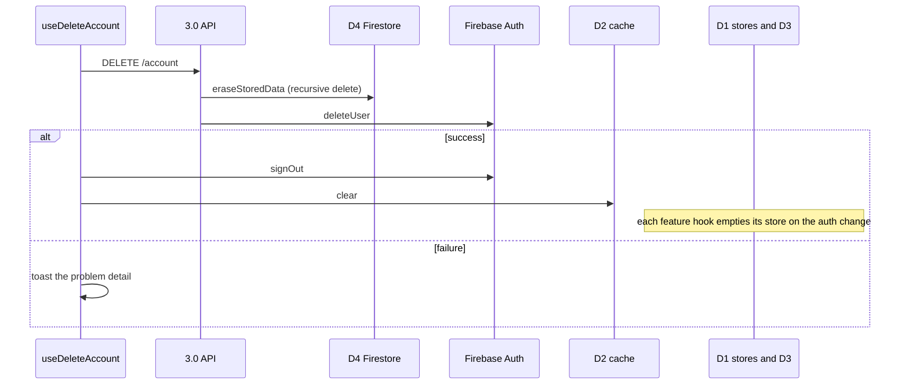

<!-- SPDX-FileCopyrightText: 2026 Alex Brandt <alunduil@gmail.com> -->
<!-- SPDX-License-Identifier: MIT -->

# Understanding data flow

User data in this system has up to four copies at once: the Firestore
document, the TanStack Query cache, a zustand store, and, for characters only,
the browser's `localStorage`. This document maps where each copy lives, which
processes move data between them, and what each client write does to each copy
when it succeeds and when it fails.

It's written for a contributor changing a write path, and for whoever settles
which copy is authoritative, the decision
[#1133](https://github.com/dungeon-studio/genshin.dungeon.studio/issues/1133) tracks.
It describes the system as it stands and decides nothing. It doesn't cover
static game data, which ships in the bundle and is never written, or the
theme preference, which stays in the browser that set it.

The diagrams are Mermaid, which GitHub renders inline. The data flow diagrams
show where data goes and nothing about order or failure. The sequence diagrams
under [Write paths](#write-paths) carry those.

---

## Context

The whole system is process `0`. Firebase Auth and the operator sit outside it
because the system exchanges data with them but doesn't control them.

---

## Level 0

Opening process `0` shows the four copies as data stores. Each labelled box is
a trust boundary:

- The browser runs on hardware the user controls.
- The API and Firestore run in the project's Google Cloud project.
- The sweep runs from an operator's own machine with that operator's
  credentials.

Two signals drive this diagram but carry no data, so they don't appear as
flows:

- A successful mutation invalidates its query key (`invalidateUserQuery`),
  which makes 4.0 refetch. No collection or team mutation writes into D2
  directly. Account deletion empties it with `queryClient.clear`.
- An auth change to anything but signed in makes 5.0's feature hook empty its
  D1 store.

Every row in D4 lives under `users/{uid}`, so `eraseStoredData` reaches every
row with one recursive delete.

---

## Write paths

The inventory works back from the sinks rather than forward from features,
because sinks are finite and searchable:

- Every non-`GET` route under `apps/api/src/routes/`.
- Every zustand `set` and `persist` call under `apps/web/src/features/`.
- Every TanStack Query `useMutation` and cache call.

That yields four features: characters, weapons, teams, and the account. Artifact
plans travel inside a team save, so they share the team path.

Each feature's hook is the only writer to its store and the only caller of its
mutations, and each feature reads from its zustand store, never from the
cache. What differs is
what the hook does on the way in and on the way back.

### Characters

`useCollection` in `use-character-collection.ts`. Add, remove, and set
constellation level share one shape: write D1, send, and on failure roll back
only if D1 still holds the value this write put there.

Signed out, the write stops at D1, and 6.0 carries it to D3.

The first time the query resolves for a user, `useServerSync` also pushes. It
merges D1 into the server collection, then sends a `PUT` for every entry the
server lacks or holds at a lower constellation. A failed push only toasts: the
merged value stays in D1, and nothing reverts it.

### Weapons

`useWeaponCollection` in `use-weapon-collection.ts`. The server mints the
instance identifier, so adding isn't optimistic, and every action is a no-op
signed out.

`ensureWeapon` keeps a set of in-flight weapon IDs so repeated clicks during
one `POST` don't create several instances.

### Teams

`useTeams` in `use-teams.ts`. Every action goes through `editThenPersist`,
which snapshots the slot, edits D1, and sends the whole team.

Nothing applies a save's response to D1, unlike `applyMutationResult` for
characters.
Signed out, teams live only in D1 and vanish on reload. A `beforeunload`
prompt guards an in-flight save.

### Account

`useDeleteAccount` in `use-delete-account.ts`. Nothing is optimistic.

Firestore goes first so a failure between the two leaves an identity that can
retry, not data with no owner.

---

## Types and conversions

Inbound, every feature runs the same chain:

1. 3.0 reads a document through the repository's `fromDocument`, which migrates
   it to the current version and asserts domain invariants.
2. The route serialises it to Collection+JSON with `characterItemDocument`,
   `weaponItemDocument`, or `teamItemDocument`.
3. The query layer asserts the document and converts each item with
   `deserialiseCharacter`, `deserialiseWeapon`, or `deserialiseTeam`.
4. The query layer folds the items into its cache shape.
5. The bridge turns the cache shape into the store shape.

| Feature    | Cache shape, step 4                                    | Store shape, step 5                                      |
| ---------- | ------------------------------------------------------ | -------------------------------------------------------- |
| Characters | `toCharacterCollection`: record keyed by `CharacterId` | `mergeCollections`: additive, higher constellation wins  |
| Weapons    | `toWeaponRecord`: record keyed by instance ID          | identity: `setWeapons` stores the cache shape            |
| Teams      | `parseTeamsResponse`: array of `CollectionTeam`        | `collectionTeamsToStore`: four slots over `initialTeams` |

Teams reads with `apiGet`, one page. Characters and weapons follow `next`
links through `apiGetAllItems`.

Outbound has no shared conversion function. Each mutation builds its request body as an object
literal: `{ constellationLevel }`, `{ weaponId, refinementLevel }`,
`{ refinementLevel }`, or, for teams, `teamToSavePayload`, which passes the
domain `CollectionTeamMembers` through unchanged. `apiPut`, `apiPost`, and
`apiPatch` send it as plain JSON. 3.0 validates the body against the request
schema, and teams rebuild members with `deserialiseCollectionTeamMembers` before
the repository's `toDocument` stamps the current schema version.

Conversions done in more than one layer:

- **Timestamps.** The server mints `createdAt` and `updatedAt` in each
  repository's `save`, for characters, weapons, and teams. The client mints its
  own in the character store's `addCharacter` and `setConstellationLevel`, in
  `preferHigherConstellation`, in the team store's edits, and in
  `createEmptyTeam`. A character keeps the client's values until a refetch
  replaces them, because `applyMutationResult` copies only the constellation
  level.
- **Default team name.** `createEmptyTeam` and the team store's `setTeamName`,
  for a blank name, both use `defaultTeamName`. The server's `nextTeam` writes
  the same string from its own template literal.
- **Merge rule.** The server's `nextCharacter` keeps the latest write. The
  client's `mergeCollections` keeps the higher constellation. The same pair of
  values resolves differently depending on which side merges.

---

## Divergences

Each feature answers the same question differently. This section records the
answers as they stand, not as defects.

| Question                                   | Characters                             | Weapons                     | Teams                         |
| ------------------------------------------ | -------------------------------------- | --------------------------- | ----------------------------- |
| Works signed out?                          | Yes, persisted to D3                   | No, every action is a no-op | Yes, in memory only           |
| Optimistic?                                | All three actions                      | Remove and refine, not add  | Every action                  |
| Applies the mutation response to D1?       | Constellation level only               | Whole instance, replaced    | No                            |
| How a refetch reaches D1                   | Additive merge                         | Replace                     | Replace, filled to four slots |
| Can a refetch overwrite an edit in flight? | Raise or add, no. Lower or remove, yes | Yes                         | Yes                           |
| What a removal elsewhere does to D1        | Survives the merge, see below          | Disappears on refetch       | Disappears on refetch         |

Things that follow from those choices, observed in the current code:

- **The character merge protects only upward edits.** `preferHigherConstellation`
  keeps the server's entry whenever the local level isn't higher. A refetch that
  lands before a lowering or removing request completes restores the old value
  in D1, even though the comment on `useServerSync` says refetches don't
  overwrite optimistic state.

- **A removal on another device comes back.** `mergeCollections` can't remove
  a character, by design, so a character removed elsewhere stays in this
  device's D1. `mergedForUser`, which stops a second push, is a `useRef`, so it
  resets whenever `useCollection` mounts again, as it does on navigating between the
  characters and teams pages. That mount's first-resolution push then sends
  the removed character back to the server. Tracked in
  [#1741](https://github.com/dungeon-studio/genshin.dungeon.studio/issues/1741).
- **The signed-out collection doesn't survive a page load.** Auth starts as
  `loading`, and `signedInUid` returns `undefined` until it settles. The clear
  effect in `useServerSync` reads that as signed out, empties D1, and 6.0
  writes the empty collection to D3. A visitor's collection therefore reaches
  the first-resolution merge only if they sign in without reloading. The hook
  tests start already signed in, so they never exercise it. Tracked in
  [#1740](https://github.com/dungeon-studio/genshin.dungeon.studio/issues/1740).
- **Teams depend on the other two features.** The server rejects a team that
  names a character or weapon instance missing from the collection. An
  optimistic character add still in flight can therefore fail a team save that
  depends on it, and the team rolls back. Removing a character or weapon
  doesn't touch the teams that name it: no layer cascades.
