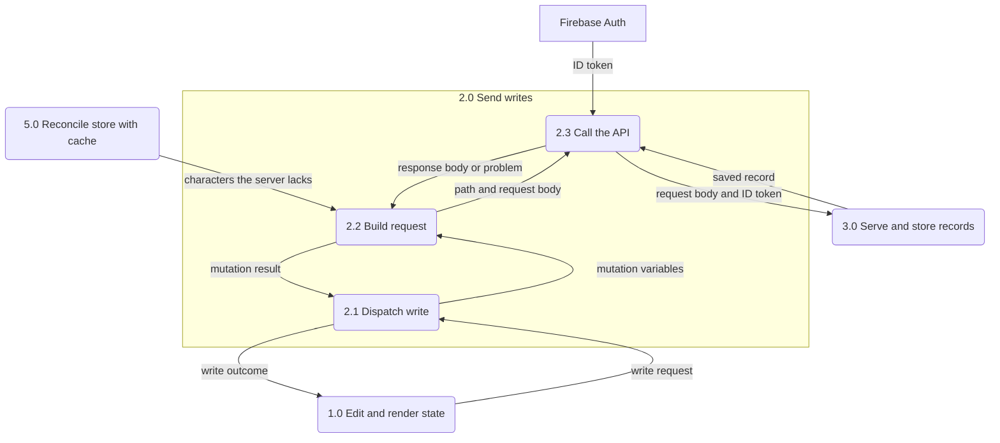

<!-- SPDX-FileCopyrightText: 2026 Alex Brandt <alunduil@gmail.com> -->
<!-- SPDX-License-Identifier: MIT -->

# Layers

The layers inside [Send writes and Serve and store records](data-flow.md#level-0),
and which jobs each layer does. Whether those layers should merge is [#1133].

| Process                      | Code                                                                                                     |
| ---------------------------- | -------------------------------------------------------------------------------------------------------- |
| 2.1 Dispatch write           | `useOptimisticActions`, `useWeaponCollection`, `editThenPersist`, `useDeleteAccount`                     |
| 2.2 Build request            | `use-character-collection-api.ts`, `use-weapon-collection-api.ts`, `use-team-api.ts`, `useDeleteAccount` |
| 2.3 Call the API             | `apps/web/src/lib/api.ts`                                                                                |
| 3.1 Authenticate caller      | `apps/api/src/middleware/auth.ts`                                                                        |
| 3.2 Validate request body    | `negotiateRequestSchema` and `validateRequestBody` under `apps/api/src/middleware/`                      |
| 3.3 Route request            | `apps/api/src/routes/`                                                                                   |
| 3.4 Read and write records   | `index.ts` under each `apps/api/src/repositories/` feature, and `merge.ts` for characters and teams      |
| 3.5 Convert stored documents | `document.ts` and `schemas/` for characters, weapons, and teams, and `schema-version.ts`                 |

## Level 1

### 2.0 Send writes

2.1 to 2.3 run in the browser.

The reconcile effect sends the sign-in push straight to 2.2, skipping the hook.

### 3.0 Serve and store records

3.1 to 3.5 run in the Google Cloud project.

A team save also reads the user's characters, weapons, and other teams through
3.4 before writing, to check its members.

## Jobs by layer

Processes 1.0, 4.0, 5.0, and 6.0 sit outside 2.0 and 3.0 but do the same jobs.

| Layer                            | Validation                                                                                                                                                                                                                                                                                                     | Invariants                                                                               | Timestamps                                                    | Identity                                                                     | Defaults                                                                                         | Schema versioning                                                             | Merging                                                                                                 |
| -------------------------------- | -------------------------------------------------------------------------------------------------------------------------------------------------------------------------------------------------------------------------------------------------------------------------------------------------------------- | ---------------------------------------------------------------------------------------- | ------------------------------------------------------------- | ---------------------------------------------------------------------------- | ------------------------------------------------------------------------------------------------ | ----------------------------------------------------------------------------- | ------------------------------------------------------------------------------------------------------- |
| 1.0 Edit and render state        | Offers only owned characters, locks a weapon another team holds, and caps artifact plan sets and minor affixes. Skips an owned add. Ignores a bad member index, an empty position, and a duplicate character. Trims a team name. Overlaps [owned-character guard], [team composition rules], [team name rules] | —                                                                                        | Characters and teams on every edit. Overlaps [timestamps]     | —                                                                            | Minimum constellation, empty teams, and the default name. Overlaps [initial level], [empty team] | —                                                                             | —                                                                                                       |
| 2.1 Dispatch write               | Skips a no-op: an owned add, a removal or level change of something not held, an unchanged level or refinement, and an `ensureWeapon` for a weapon owned or in flight. Overlaps [owned-character guard]                                                                                                        | —                                                                                        | —                                                             | —                                                                            | —                                                                                                | —                                                                             | Guarded rollback. Applies a response: characters' level, weapons' whole instance. Overlaps [merge rule] |
| 2.2 Build request                | Asserts a character or weapon response is Collection+JSON with one item. Team mutations discard theirs                                                                                                                                                                                                         | `deserialise*` on character and weapon responses. Overlaps [domain invariants]           | —                                                             | Puts the character ID, instance ID, or slot in the path                      | Minimum constellation and refinement in add bodies. Overlaps [initial level]                     | —                                                                             | —                                                                                                       |
| 2.3 Call the API                 | None: trusts a problem document on its content type                                                                                                                                                                                                                                                            | —                                                                                        | —                                                             | Attaches the signed-in user's ID token                                       | —                                                                                                | —                                                                             | —                                                                                                       |
| 3.1 Authenticate caller          | Rejects a missing or malformed `Authorization` header                                                                                                                                                                                                                                                          | —                                                                                        | —                                                             | Verifies the ID token. Its user ID keys all storage                          | —                                                                                                | —                                                                             | —                                                                                                       |
| 3.2 Validate request body        | Rejects a malformed `Content-Type`, an unknown `profile`, a body that isn't JSON, and one that breaks the schema: types, ranges, lengths, member count, artifact plan fields, extra properties. Overlaps [team name rules], [team composition rules]                                                           | —                                                                                        | —                                                             | —                                                                            | —                                                                                                | Picks the request schema from the `profile`. Overlaps [schema versions]       | —                                                                                                       |
| 3.3 Route request                | Catalogue check on IDs and the `weaponId` filter, slot range, team composition and ownership. Overlaps [team composition rules]                                                                                                                                                                                | `deserialiseCollectionTeamMembers`. Overlaps [domain invariants]                         | —                                                             | Takes the character ID or slot from the path. Casts an instance ID unchecked | —                                                                                                | —                                                                             | —                                                                                                       |
| 3.4 Read and write records       | Reports a missing weapon instance on update. Skips a team document whose ID isn't a slot                                                                                                                                                                                                                       | —                                                                                        | Mints both, keeps a stored `createdAt`. Overlaps [timestamps] | Mints the weapon instance ID                                                 | `nextTeam`'s name and empty members. Overlaps [empty team]                                       | —                                                                             | `nextCharacter`, the weapon update, `nextTeam`. Overlaps [merge rule]                                   |
| 3.5 Convert stored documents     | Rejects a document no version accepts                                                                                                                                                                                                                                                                          | `assertCollection*` after migrating. Overlaps [domain invariants]                        | —                                                             | Takes the ID from the document key                                           | Pads a short `members` array to four. Overlaps [empty team]                                      | Migrates on read. `toDocument` stamps the version. Overlaps [schema versions] | —                                                                                                       |
| 4.0 Fetch records                | Asserts every page is Collection+JSON                                                                                                                                                                                                                                                                          | `deserialise*` on every item. Overlaps [domain invariants]                               | —                                                             | —                                                                            | —                                                                                                | —                                                                             | —                                                                                                       |
| 5.0 Reconcile store with cache   | —                                                                                                                                                                                                                                                                                                              | —                                                                                        | Character merge and unsaved team slots. Overlaps [timestamps] | —                                                                            | Fills unsaved team slots with empty teams. Overlaps [empty team]                                 | —                                                                             | Characters additive, higher constellation wins. Weapons and teams replace. Overlaps [merge rule]        |
| 6.0 Persist character collection | On a version change, drops a stored collection that doesn't parse                                                                                                                                                                                                                                              | On a version change, `assertCollectionCharacter` per entry. Overlaps [domain invariants] | —                                                             | —                                                                            | —                                                                                                | zustand `persist` version. Overlaps [schema versions]                         | —                                                                                                       |

## Overlaps

Each overlap is a job more than one layer does.

### Timestamps

The server mints `createdAt` and `updatedAt` on every save and keeps the stored
`createdAt`. The client mints both on a character add and for every unsaved
team slot. It mints `updatedAt` on every other character and team store edit,
and on a character merge that keeps the local level. The weapon store never
mints them. When the server's values reach each store is in
[Lifecycles](data-flow-lifecycles.md).

### Initial level

The character store and the add mutation each pick `MIN_CONSTELLATION_LEVEL`.
The server requires the field and has no default.

### Empty team

`createEmptyTeam` on the client and `nextTeam` on the server each define the
default name and the four empty member slots. `fromDocument` pads a stored
`members` array shorter than four.

### Team name rules

The client trims a name and falls back to the default when it's blank. The
server doesn't trim and accepts 1 to 50 characters, a limit the client doesn't
enforce.

### Team composition rules

The client ignores a duplicate character in a team, and the server rejects one.
The planner UI, the request schema, and the route's `validateArtifactPlan` each
enforce part of the artifact plan limits. The planner UI offers only owned
characters and locks a weapon another team holds. The server rejects both.

### Owned-character guard

`useOptimisticActions` and the store's `addCharacter` each skip adding a
character the store already holds.

### Domain invariants

Asserted by the client's `deserialise*` functions, by the route's
`deserialiseCollectionTeamMembers`, by the repository's `fromDocument`, and by
the persisted character store's migration, which runs only on a version change.

### Schema versions

Request schemas, Firestore documents, and the `localStorage` collection each
carry their own version. The client sends no `profile` parameter, so the server
validates against its latest request schema.

### Merge rule

The server keeps the latest write for characters and weapons. For teams it
keeps any stored field the body omits. The client's `mergeCollections` keeps the
higher constellation, so the same two character values resolve differently
depending on which side merges. The hook's guarded rollback keeps a newer local
edit over the rollback.

[#1133]: https://github.com/dungeon-studio/genshin.dungeon.studio/issues/1133
[domain invariants]: #domain-invariants
[empty team]: #empty-team
[initial level]: #initial-level
[merge rule]: #merge-rule
[owned-character guard]: #owned-character-guard
[schema versions]: #schema-versions
[team composition rules]: #team-composition-rules
[team name rules]: #team-name-rules
[timestamps]: #timestamps
