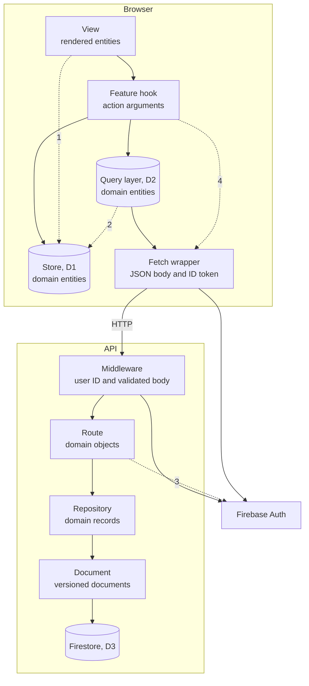
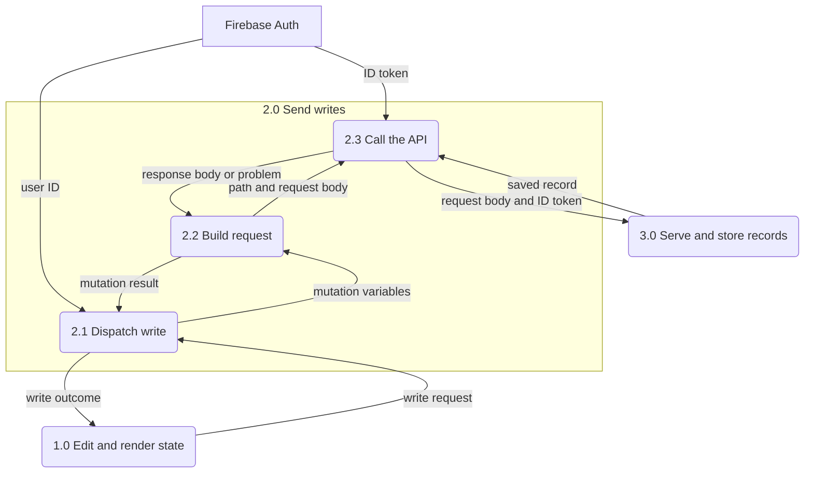
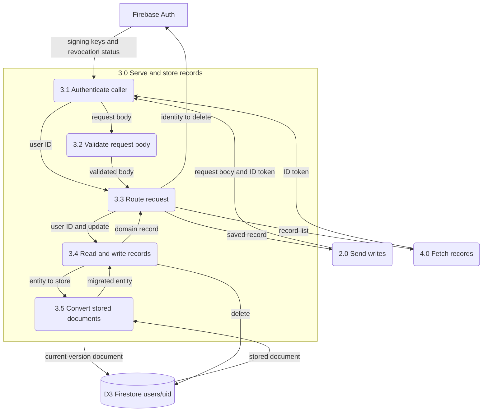

<!-- SPDX-FileCopyrightText: 2026 Alex Brandt <alunduil@gmail.com> -->
<!-- SPDX-License-Identifier: MIT -->

# Layers

The layer stacks user data crosses between the browser and Firestore, where the
code skips a layer, and which jobs each layer does. [ADR-0006] decides
which layering the client should have.

## Stack

A request travels down the browser layers, over HTTP, and down the API layers.
Solid arrows join adjacent layers. Each dashed arrow is a skip, numbered under
[Skips](#skips).

| Layer           | Code                                                                       | Data unit                               |
| --------------- | -------------------------------------------------------------------------- | --------------------------------------- |
| View            | `apps/web/src/pages/` and feature components                               | Rendered entities and user actions      |
| Feature hook    | `useCollection`, `useWeaponCollection`, `useTeams`, `useDeleteAccount`     | Action arguments                        |
| Store, D1       | `use-*-store.ts`                                                           | `CollectionCharacter`, `CollectionTeam` |
| Query layer, D2 | `use-*-api.ts` and `apps/web/src/lib/api-collection.ts`                    | Collection+JSON in, domain entities out |
| Fetch wrapper   | `apps/web/src/lib/api.ts`                                                  | JSON body with the ID token             |
| Middleware      | `apps/api/src/middleware/`                                                 | User ID and validated body              |
| Route           | `apps/api/src/routes/`                                                     | Domain objects in, Collection+JSON out  |
| Repository      | `index.ts` under each `apps/api/src/repositories/` feature, and `merge.ts` | Domain records                          |
| Document        | `document.ts`, `schemas/`, and `schema-version.ts`                         | Versioned Firestore documents           |

`@genshin/domain` supplies the types, assertions, and Collection+JSON
representations every layer uses.

## Skips

1. **View to store.** `character-pool.tsx` and `weapon-pool.tsx` read
   `useTeamStore` instead of `useTeams`, see [#1846]. `ClearUserDataOnSignOut`
   empties every store on sign-out without a feature hook, see [#1889].
2. **Query layer to store.** The character and team hooks' reconcile effects
   copy the cache into the store, so the store has four writers: actions, responses, reconcile,
   and the sign-out clear. [ADR-0006] decides which copy owns state.
3. **Route to Firebase Auth.** `routes/account.ts` calls `deleteUser`, outside
   the boundaries [#1020] sets.
4. **Feature hook to fetch wrapper.** `useDeleteAccount` defines its own
   mutation and calls `apiDelete`, see [#1849].

## Jobs by layer

Each job lists, in stack order, only the layers that do it. An overlap is a
rule more than one layer implements.

Business rules split between the route and the repository. Routes hold
catalogue checks, team composition, and cross-feature reads. Repositories hold
merges, timestamps, and instance IDs. See [#1848].

### Validation

- **View:** offers only owned characters not already in the team, locks a
  weapon another team holds, and caps artifact plan sets and minor affixes.
  Overlaps [team composition rules].
- **Feature hook:** skips a no-op: an owned add, a removal or level change of
  something not held, an unchanged level or refinement, and an `ensureWeapon`
  for a weapon owned or in flight. Overlaps [owned-character guard].
- **Store:** skips an owned add and a response for a character no longer held.
  Ignores a bad member index, an empty position,
  and a duplicate character. Trims a team name. Overlaps
  [owned-character guard], [team composition rules], [team name rules].
- **Query layer:** asserts every response is Collection+JSON, with one item for
  a character or weapon mutation. Team mutations discard theirs.
- **Fetch wrapper:** none. Trusts a problem document on its content type.
- **Middleware:** rejects a missing or malformed `Authorization` header, a
  malformed `Content-Type`, an unknown `profile`, and a body that isn't JSON.
  Rejects a body that breaks the schema: types, ranges, lengths, member count,
  artifact plan fields, extra properties. Overlaps [team name rules],
  [team composition rules].
- **Route:** catalogue check on IDs and the `weaponId` filter, slot range, team
  composition and ownership. Overlaps [team composition rules].
- **Repository:** reports a missing weapon instance on update. Skips a team
  document whose ID isn't a slot.
- **Document:** rejects a document no version accepts.

#### Team name rules

The client trims a name and falls back to the default when it's blank. The
server doesn't trim and accepts 1 to 50 characters, a limit the client doesn't
enforce.

#### Team composition rules

The planner UI disables and the store ignores a duplicate character in a team,
and the server rejects one.
The planner UI, the request schema, and the route's `validateArtifactPlan` each
enforce part of the artifact plan limits. The planner UI offers only owned
characters and locks a weapon another team holds, and the server rejects
both.

#### Owned-character guard

`useOptimisticActions` and the store's `addCharacter` each skip adding a
character the store already holds.

### Invariants

Each layer below asserts the same domain invariants, an overlap.

- **Query layer:** every item, through `deserialise*`.
- **Route:** team members, through `deserialiseCollectionTeamMembers`.
- **Document:** every document after migrating, through `assertCollection*`.

### Timestamps

Each layer below mints `createdAt` and `updatedAt`, an overlap.
When the server's values reach each store is in
[Lifecycles](data-flow-lifecycles.md).

- **Feature hook:** both for every unsaved team slot.
- **Store:** both on a character add, and on every team slot at start and on
  reset. `updatedAt` on every other character and
  team edit. Weapons never mint them in the browser.
- **Repository:** both on every save, keeping a stored `createdAt`.

### Identity

- **View:** `ClearUserDataOnSignOut` empties every store when a signed-in user
  signs out or another account signs in.
- **Feature hook:** applies a character response or rollback, and shows a
  character or weapon toast, only while its sender is still signed in.
- **Query layer:** puts the character ID, instance ID, or slot in the path.
  Writes a weapon response or rollback into its sender's cache entry.
- **Fetch wrapper:** attaches the signed-in user's ID token.
- **Middleware:** verifies the ID token. Its user ID keys all storage.
- **Route:** takes the character ID or slot from the path. Casts an instance ID
  unchecked.
- **Repository:** mints the weapon instance ID.
- **Document:** takes the ID from the document key.

### Defaults

- **Feature hook:** fills unsaved team slots with empty teams. Overlaps
  [empty team].
- **Store:** minimum constellation, empty teams, and the default name. Overlaps
  [initial level], [empty team].
- **Query layer:** minimum constellation and refinement in add bodies. Overlaps
  [initial level].
- **Repository:** `nextTeam`'s name and empty members. Overlaps [empty team].
- **Document:** pads a short `members` array to four. Overlaps [empty team].

#### Initial level

The character store and the add mutation each pick `MIN_CONSTELLATION_LEVEL`.
The server requires the field and has no default.

#### Empty team

`createEmptyTeam` in `@genshin/domain`, used by the client, and `nextTeam` on
the server each define the default name and the four empty member slots.

### Schema versioning

Each layer below versions its own format, an overlap.

- **Middleware:** picks the request schema from the `profile`. The client sends
  no `profile`, so the server validates against its latest request schema.
- **Document:** migrates on read. `toDocument` stamps the version.

### Merging

The hook and the repository merge by different rules, an overlap. The same two
character values resolve differently on each side.

- **Feature hook:** [guarded rollback](data-flow-write-paths.md) for characters
  and teams. Applies a character's whole record from a response unless it's no
  longer held. Reconciles by replacing the store with the server's collection.
- **Query layer:** guarded rollback for weapons. Applies a weapon's whole
  instance from a response.
- **Repository:** `nextCharacter` and the weapon update keep the latest write.
  `nextTeam` keeps any stored field the body omits.

## Level 1 data flow

The [Level 0](data-flow.md#level-0) processes 2.0 and 3.0 decompose onto the
stack. 2.1 is the feature hook, 2.2 the query layer, and 2.3 the fetch wrapper.
3.1 and 3.2 are the middleware, 3.3 the route, 3.4 the repository, and 3.5 the
document layer.

### 2.0 Send writes

2.1 to 2.3 run in the browser.

### 3.0 Serve and store records

3.1 to 3.5 run in the Google Cloud project.

A team save also reads the user's characters, weapons, and other teams through
3.4 before writing, to check its members.

[#1020]: https://github.com/dungeon-studio/genshin.dungeon.studio/issues/1020
[ADR-0006]: ../explanation/adr-0006-client-data-layer.md
[#1846]: https://github.com/dungeon-studio/genshin.dungeon.studio/issues/1846
[#1848]: https://github.com/dungeon-studio/genshin.dungeon.studio/issues/1848
[#1849]: https://github.com/dungeon-studio/genshin.dungeon.studio/issues/1849
[#1889]: https://github.com/dungeon-studio/genshin.dungeon.studio/issues/1889
[empty team]: #empty-team
[initial level]: #initial-level
[owned-character guard]: #owned-character-guard
[team composition rules]: #team-composition-rules
[team name rules]: #team-name-rules
