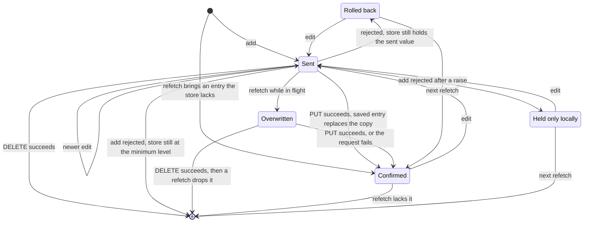
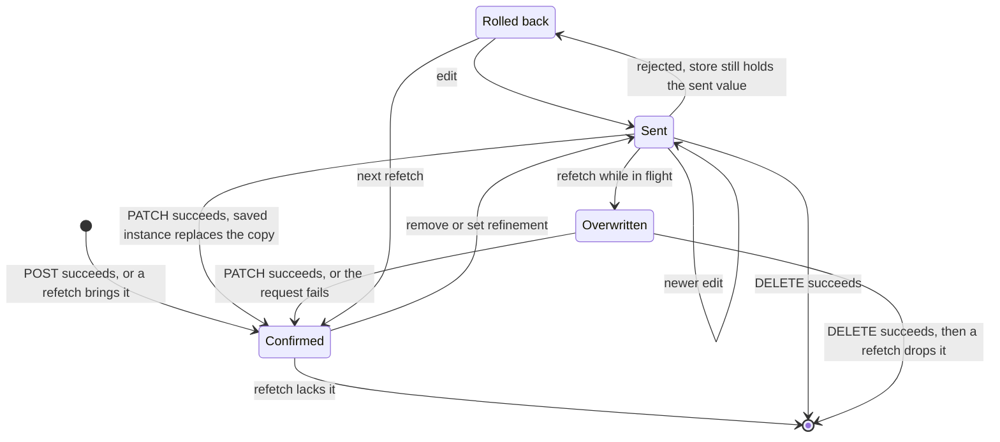
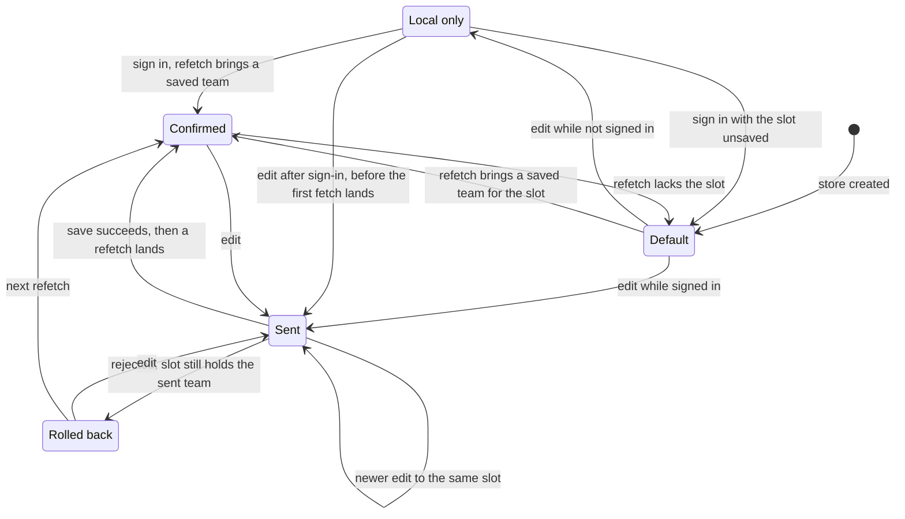

<!-- SPDX-FileCopyrightText: 2026 Alex Brandt <alunduil@gmail.com> -->
<!-- SPDX-License-Identifier: MIT -->

# Lifecycles

The states one entity's copy in the
[zustand store, D1](data-flow.md#level-0) moves through, per feature. Each
diagram follows one character, one weapon instance, or one team slot. [ADR-0006]
decides whether the features share one write lifecycle. What a request carries
from each copy is in [Data conversions](data-flow-conversions.md#outbound).

The features share five states:

- **Local only:** in the store, never sent.
- **Sent:** edited in the store, with a request in flight.
- **Confirmed:** matches what the server last returned.
- **Rolled back:** restored to its value before a rejected request.
- **Overwritten:** replaced by a refetch while a request is still in flight.

In every feature:

- From every state, the store empties when a signed-in user signs out or
  another account signs in, whichever page is open. A team slot resets to
  Default instead. Auth settling on page load isn't a sign-out.
- While signed in, a refetch runs on window focus, on reconnect, when a hook
  mounts, and after a successful mutation in the same feature unless another is
  still pending. A mount first applies the cached result. A character or weapon
  refetch changes the store only when its result differs.
- Sending a request cancels any refetch already in flight, except the first
  load. The first load, or a refetch that starts after the request, can still
  land before the request settles. A character or weapon refetch that lands in
  that window reaches the store. The team store skips it.
- Only the latest character or weapon request of each kind through a hook gets
  its response handling: confirm, rollback, and toast. An earlier one, or one
  that settles after the user leaves its page, reaches the store only through a
  refetch, see [#1534]. A character or weapon request that settles after
  sign-out leaves the store untouched. Every team request gets its rollback and
  toast, even after the user leaves the teams page. One that fails after
  sign-out shows only its toast.
- Requests of different kinds through one hook settle in any order, so a
  response can undo a newer edit. The response to an add can put the minimum
  level back over a raise, and a refinement's response can put an instance back
  after a removal.

## Characters

- No local-only state: every action is a no-op while not signed in.
- Confirmed by a response: the saved entry replaces the copy, server timestamps
  included. A response for a character removed since is skipped.
- Confirmed by a refetch: the store takes the server's entry whole.
- Rolled back: a rolled-back removal returns with new client timestamps.
- Overwritten: a refetch replaces the whole store, so a refetch the request
  didn't cancel overwrites any edit in flight.
- Held only locally: a rejected add with a raised level only toasts, leaving a
  copy the server lacks. The next refetch drops it, and an edit writes it to
  the server.

## Weapons

- No local-only state: every action is a no-op while not signed in, and an add
  reaches the store only from the server.
- Confirmed by a response: the saved instance replaces the copy, server
  timestamps included.
- Rolled back: a rolled-back removal returns the exact instance it removed.
- Overwritten: a refetch replaces the whole store, so a refetch the request
  didn't cancel overwrites any edit in flight.

## Teams

- Default: `createEmptyTeam`, with the default name, four empty positions, and
  client-minted timestamps. A refetch, a signed-in mount, or a sign-out
  rebuilds it with new timestamps whenever the server holds nothing for the
  slot.
- Local only: in memory, so it survives moving between pages but not a page
  load. Signing in replaces it rather than merging it.
- Confirmed: a response never reaches the store. Only a refetch confirms it,
  server timestamps included. A save that succeeds while another team save is
  pending skips its refetch and waits on that save's.
- Cleared: an edit like any other. The slot keeps its name, so a clear never
  returns it to Default.
- Edits in flight: a refetch that lands while any team save is pending
  leaves the store alone. The refetch the last request starts updates it. If
  that request fails, nothing refetches, and the store keeps its rolled-back
  slots until the next refetch, see [#550].

[#550]: https://github.com/dungeon-studio/genshin.dungeon.studio/issues/550
[ADR-0006]: ../explanation/adr-0006-client-data-layer.md
[#1534]: https://github.com/dungeon-studio/genshin.dungeon.studio/issues/1534
