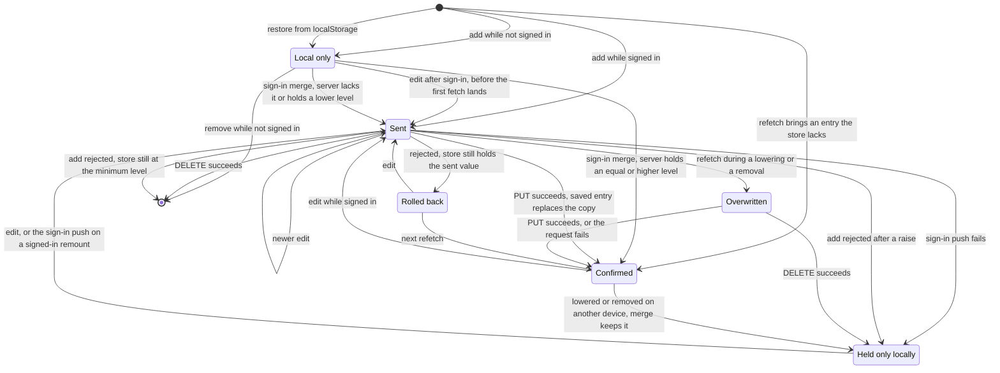
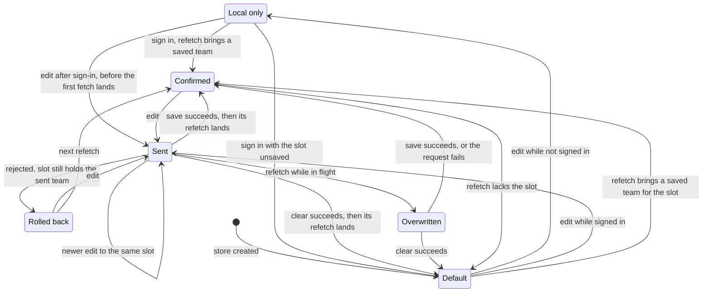

<!-- SPDX-FileCopyrightText: 2026 Alex Brandt <alunduil@gmail.com> -->
<!-- SPDX-License-Identifier: MIT -->

# Lifecycles

The states one entity's copy in the
[zustand store, D1](data-flow.md#level-0) moves through, per feature. Each
diagram follows one character, one weapon instance, or one team slot. Whether
the features should share one state machine is [#1133]. What a request carries
from each copy is in [Data conversions](data-flow-conversions.md#outbound).

The features share five states:

- **Local only:** in the store, never sent.
- **Sent:** edited in the store, with a request in flight.
- **Confirmed:** matches what the server last returned.
- **Rolled back:** restored to its value before a rejected request.
- **Overwritten:** replaced by a refetch while a request is still in flight.

In every feature:

- From every state, the store empties when a signed-in user signs out or
  another account signs in, whichever page is open. A team slot resets to
  Default instead. Auth settling on page load isn't a sign-out.
- While signed in, a refetch runs after any successful mutation in the same
  feature, on window focus, on reconnect, and when a hook mounts. A mount first
  applies the cached result. A refetch changes the store only when its result
  differs. It can land while any request is in flight.
- Only the latest request of each kind through a hook gets its response
  handling: confirm, rollback, and toast. An earlier request, or one that
  settles after the user leaves its page, reaches the store only through a
  refetch, see [#1534]. A character or weapon request that settles after
  sign-out leaves the store untouched. A team request can still show its
  failure toast.
- Requests of different kinds through one hook settle in any order, so a
  response can undo a newer edit. The response to an add can put the minimum
  level back over a raise, and a refinement's response can put an instance back
  after a removal. A character response never puts back a removed character.

## Characters

- Local only: persisted in `localStorage`, so it survives page loads until the
  sign-in merge. A session that ends while no tab is open isn't seen as a
  sign-out, so its characters stay local.
- Confirmed by a response: the saved entry replaces the copy, server timestamps
  included. A response for a character removed since is skipped.
- Confirmed by a refetch: the store takes the server's `createdAt`, and its
  `updatedAt` only where the server's level is at least the local one.
- Rolled back: a rolled-back removal returns with new client timestamps.
- Overwritten: a refetch merges additively, so a raise or an add in flight
  survives it.
- Held only locally: a copy ahead of the server, which lacks it or holds a lower
  level. A failed sign-in push or a rejected add with a raised level only
  toasts, so each leaves one, see [#1840]. The merge keeps the copy until the
  store empties, and an edit or a sign-in push writes it back to the server, see
  [#1741].

## Weapons

- No local-only state: every action is a no-op while not signed in, and an add
  reaches the store only from the server.
- Confirmed by a response: the saved instance replaces the copy, server
  timestamps included.
- Rolled back: a rolled-back removal returns the exact instance it removed.
- Overwritten: a refetch replaces the whole store, so any edit in flight is
  overwritten.

## Teams

- Default: `createEmptyTeam`, with the default name, four empty positions, and
  client-minted timestamps. A changed refetch, a signed-in mount, or a sign-out
  rebuilds it with new timestamps whenever the server holds nothing for the
  slot.
- Local only: in memory, so it survives moving between pages but not a page
  load. Signing in replaces it rather than merging it.
- Confirmed: a response never reaches the store. Only the refetch the save
  triggers confirms it, server timestamps included.
- Sent by a clear: no component calls `clearTeam`. The store keeps the team's
  name and empties its positions. The server deletes the record, so the refetch
  brings back the default name, see [#1839].
- Overwritten: a refetch replaces all four slots, so a save in one slot
  overwrites an edit in flight in another.

[#1133]: https://github.com/dungeon-studio/genshin.dungeon.studio/issues/1133
[#1534]: https://github.com/dungeon-studio/genshin.dungeon.studio/issues/1534
[#1741]: https://github.com/dungeon-studio/genshin.dungeon.studio/issues/1741
[#1839]: https://github.com/dungeon-studio/genshin.dungeon.studio/issues/1839
[#1840]: https://github.com/dungeon-studio/genshin.dungeon.studio/issues/1840
