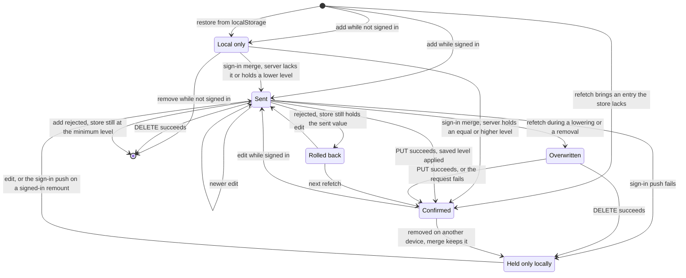

<!-- SPDX-FileCopyrightText: 2026 Alex Brandt <alunduil@gmail.com> -->
<!-- SPDX-License-Identifier: MIT -->

# Lifecycles

The states one entity's copy in the
[zustand store, D1](data-flow.md#level-0), moves through, per feature. Each
diagram follows one character, one weapon instance, or one team slot. Whether
the features should share one state machine is [#1133].

The states the features share:

- **Local only:** in the store, never sent.
- **Sent:** edited in the store, with a request in flight.
- **Confirmed:** matches what the server last returned.
- **Rolled back:** restored to its value before a rejected request.
- **Overwritten:** replaced by a refetch while a request is still in flight.

A refetch runs after any successful mutation in the same feature, on window
focus, on reconnect, and when a hook mounts, so it can land while any request is in flight.

## Characters



From every state, the store empties when the hook mounts, or auth changes, while
not signed in. Auth starts out loading on every page load, so the store drops an
entry restored from `localStorage` before sign-in settles, see [#1740].

- Sent: the request carries only the level, never the entry's timestamps.
- Confirmed by a response: only the saved level reaches the store, which mints a
  new `updatedAt`. The server's timestamps arrive only through a refetch where
  the server's level is at least the local one.
- Rolled back: a rolled-back removal returns with new client timestamps.
- Overwritten: a refetch merges additively, so a raise or an add in flight
  survives it.
- Held only locally: a copy ahead of the server, which lacks it or holds a lower
  level. A failed sign-in push only toasts, so it leaves one. The merge keeps the
  copy until the store empties, and an edit or a sign-in push writes it back to
  the server, see [#1741].

## Weapons


From every state, the store empties when auth isn't signed in.

- No local-only state: every action is a no-op while not signed in, and an add
  reaches the store only from the server's response.
- Rolled back: a rolled-back removal returns the exact instance it removed.
- Overwritten: a refetch replaces the whole store, so any edit in flight is
  overwritten.

## Teams

```mermaid
stateDiagram-v2
  state "Local only" as LocalOnly
  state "Rolled back" as RolledBack

  [*] --> Default: store created
  Default --> LocalOnly: edit while not signed in
  Default --> Sent: edit while signed in
  Default --> Confirmed: refetch brings a saved team for the slot
  LocalOnly --> Confirmed: sign in, refetch brings a saved team
  LocalOnly --> Default: sign in with the slot unsaved, or the hook mounts
  Sent --> Sent: newer edit to the same slot
  Sent --> Confirmed: save succeeds, then its refetch lands
  Sent --> Default: clear succeeds, then its refetch lands
  Sent --> RolledBack: rejected, slot still holds the sent team
  Sent --> Overwritten: refetch while in flight
  Overwritten --> Confirmed: save succeeds, or the request fails
  Overwritten --> Default: clear succeeds
  Confirmed --> Sent: edit
  Confirmed --> Default: refetch lacks the slot
  RolledBack --> Sent: edit
  RolledBack --> Confirmed: next refetch
```

From every state, the slot resets to Default when the hook mounts, or auth
changes, while not signed in.

- Default: `createEmptyTeam`, with the default name, four empty positions, and
  client-minted timestamps. A refetch rebuilds it with new timestamps whenever
  the server holds nothing for the slot.
- Local only: in memory only. Signing in replaces it rather than merging it.
- Confirmed: a response never reaches the store. Only the refetch the save
  triggers confirms it.
- Sent by a clear: the store keeps the team's name and empties its positions.
  The server deletes the record, so the refetch brings back the default name.
- Overwritten: a refetch replaces all four slots, so a save in one slot
  overwrites an edit in flight in another.

[#1133]: https://github.com/dungeon-studio/genshin.dungeon.studio/issues/1133
[#1740]: https://github.com/dungeon-studio/genshin.dungeon.studio/issues/1740
[#1741]: https://github.com/dungeon-studio/genshin.dungeon.studio/issues/1741
