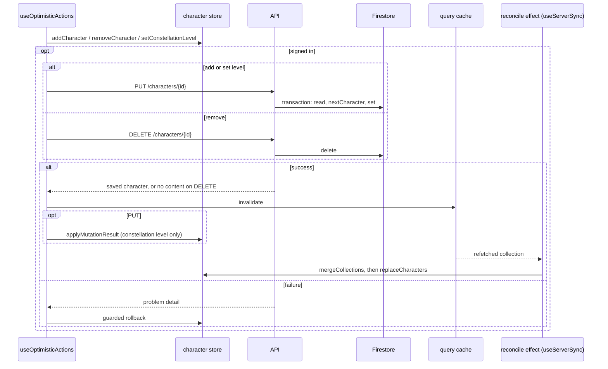
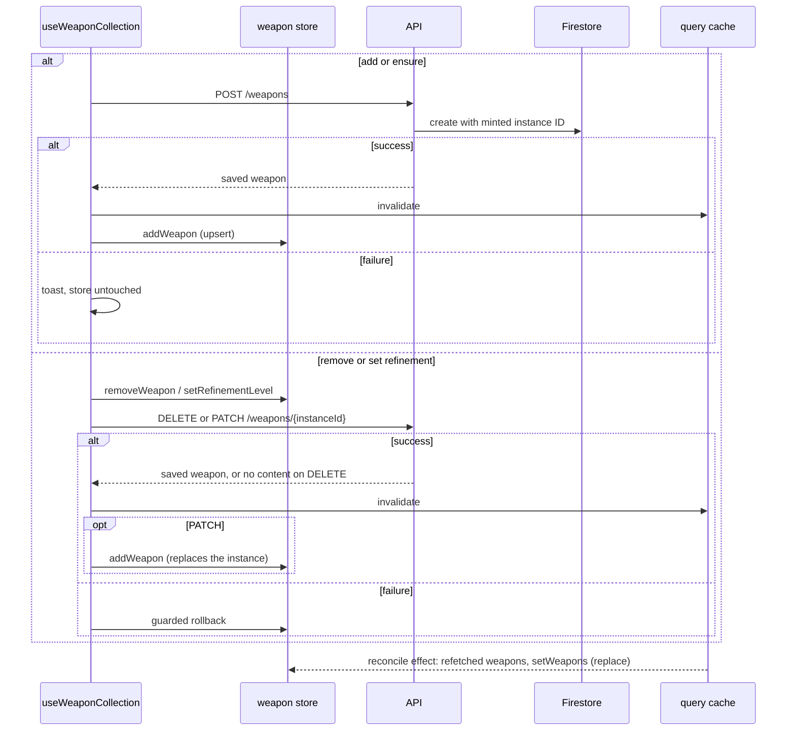
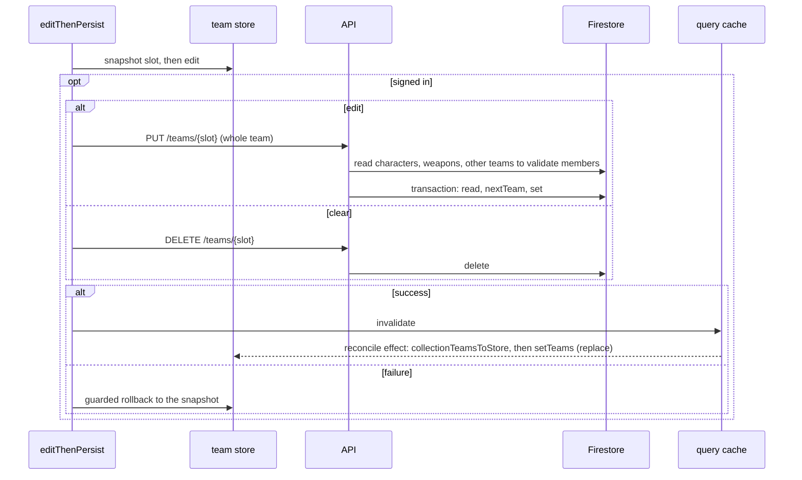
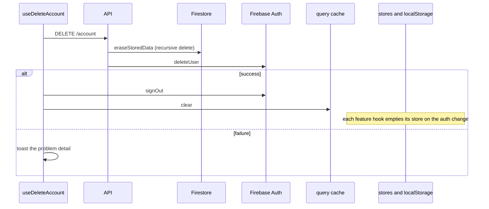

<!-- SPDX-FileCopyrightText: 2026 Alex Brandt <alunduil@gmail.com> -->
<!-- SPDX-License-Identifier: MIT -->

# Write paths

What each client write does to each
[copy of user data](data-flow.md#level-0), in order, on success and on failure.

A write path is any code that reaches one of these:

- A non-`GET` route under `apps/api/src/routes/`.
- A zustand `set` or `persist` call under `apps/web/src/features/`.
- A TanStack Query mutation or cache call.

Four features do: characters, weapons, teams, and the account. Artifact plans
travel inside a team save, so they share the team path.

Each feature's hook is the only writer to its store and the only caller of its
mutations. Each feature reads from its zustand store, never from the cache.
Each hook also runs its own reconcile effect, which copies the refetched cache
into the store whenever the query data changes.

Every optimistic write fails the same way, a guarded rollback. The previous
value comes back only if the store still holds the value that write put there,
so a newer edit stands. A toast shows either way, and nothing retries.

## Characters

`useCollection` in `use-character-collection.ts`. Add, remove, and set
constellation level share one shape: write the store, send, and on failure make
a guarded rollback.

The first time the query resolves for a signed-in user, `useServerSync` also
makes the sign-in push. It merges the store into the server collection, then
sends a `PUT` for every entry the server lacks or holds at a lower
constellation. A failed push only toasts. The merged value stays in the store.

## Weapons

`useWeaponCollection` in `use-weapon-collection.ts`. The server mints the
instance identifier, so adding can't be optimistic and nothing works signed
out.

## Teams

`useTeams` in `use-teams.ts`. Every action goes through `editThenPersist`,
which snapshots the slot, edits the store, and sends the whole team.

A `beforeunload` prompt guards an in-flight save.

## Account

`useDeleteAccount` in `use-delete-account.ts`. Nothing is optimistic.

Every document in Firestore lives under `users/{uid}`, so `eraseStoredData`
reaches all of them with one recursive delete. Firestore goes first so a failure
between the two leaves an identity that can retry, not data with no owner.

## Divergences

Characters, weapons, and teams differ on each of these questions:

| Question                                    | Characters                             | Weapons                     | Teams                         |
| ------------------------------------------- | -------------------------------------- | --------------------------- | ----------------------------- |
| Works signed out?                           | Yes, but lost on reload, see [#1740]   | No, every action is a no-op | Yes, in memory only           |
| Optimistic?                                 | All three actions                      | Remove and refine, not add  | Every action                  |
| Applies the mutation response to the store? | Constellation level only               | Whole instance, replaced    | No                            |
| How a refetch reaches the store             | Additive merge                         | Replace                     | Replace, filled to four slots |
| Can a refetch overwrite an edit in flight?  | Raise or add, no. Lower or remove, yes | Yes                         | Yes                           |
| What a removal elsewhere does to the store  | Survives the merge, see [#1741]        | Disappears on refetch       | Disappears on refetch         |

Teams also depend on the other two features. The server rejects a team that
names a character or weapon instance the user doesn't own, so a team save can
fail on a character add still in flight. Removing a character or weapon leaves
the teams that name it unchanged.

[#1740]: https://github.com/dungeon-studio/genshin.dungeon.studio/issues/1740
[#1741]: https://github.com/dungeon-studio/genshin.dungeon.studio/issues/1741
