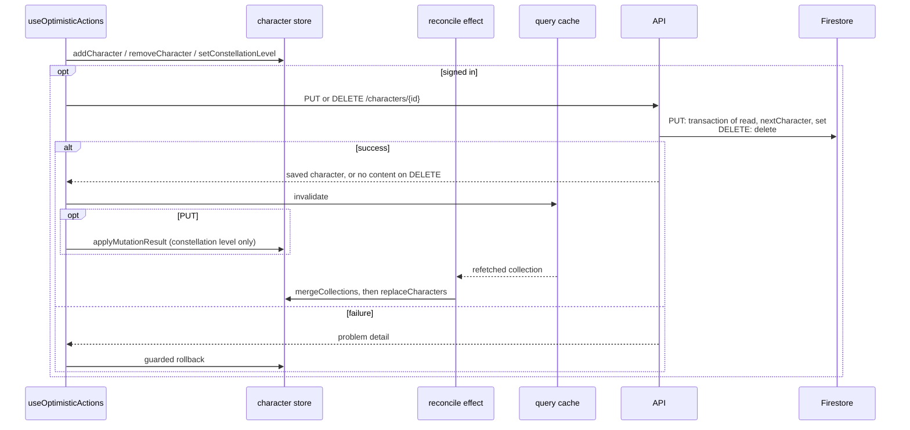
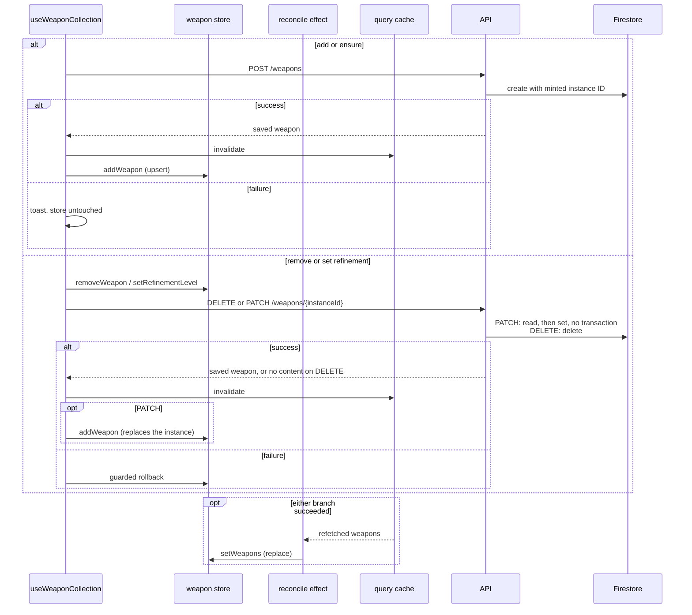
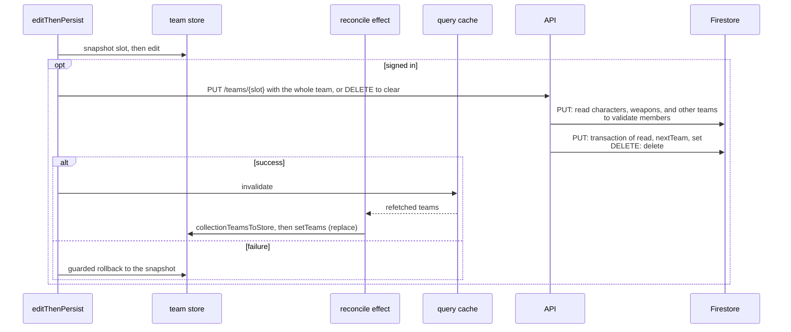
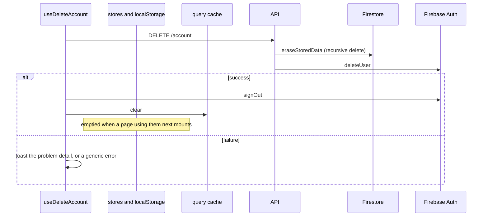

<!-- SPDX-FileCopyrightText: 2026 Alex Brandt <alunduil@gmail.com> -->
<!-- SPDX-License-Identifier: MIT -->

# Write paths

What each client write does to each
[copy of user data](data-flow.md#level-0), in order, on success and on failure.
In the sequence diagrams, an `alt` box runs exactly one of its bracketed
branches, and an `opt` box runs only when its condition holds.

A write path is any code that reaches one of these:

- A non-`GET` route under `apps/api/src/routes/`.
- A zustand `set` or `persist` call under `apps/web/src/features/`.
- A TanStack Query mutation or cache call.

Four features do: characters, weapons, teams, and the account. Artifact plans
travel inside a team save, so they share the team path.

Each feature's hook is the only writer to its store and the only caller of its
mutations. Each feature reads from its zustand store, never from the cache.

A write skips both client copies: the hook edits the store and calls the API
directly. The server's state comes back the other way, through a refetch into
the query cache and then the hook's own reconcile effect into the store.
Characters also apply the saved constellation level from the mutation response
to the store directly, and weapons the whole saved instance.

Every optimistic write fails the same way, a guarded rollback. The previous
value comes back only if the store still holds the value that write put there,
so a newer edit stands. A toast shows either way, and nothing retries. Both run
in per-call mutation callbacks, which fire only for the latest call on each
mutation hook. A write that fails after a later one from the same hook has
started gets no rollback and no toast, see [#1757].

## Characters

`useCollection` in `use-character-collection.ts`.

Each time `useCollection` mounts for a signed-in user and the query resolves,
the reconcile effect, `useServerSync`, also makes the sign-in push, see [#1741]. It merges the store into the server collection, then
sends a `PUT` for every entry the server lacks or holds at a lower
constellation. A failed push only toasts, and only for the last entry sent. The
merged value stays in the store.

## Weapons

`useWeaponCollection` in `use-weapon-collection.ts`. The server mints the
instance identifier, so adding can't be optimistic and nothing works signed
out.

## Teams

`useTeams` in `use-teams.ts`. Every action goes through `editThenPersist`.

On the teams page, a `beforeunload` prompt guards the latest in-flight save.

## Account

`useDeleteAccount` in `use-delete-account.ts`. Nothing is optimistic.

Every document in Firestore lives under `users/{uid}`, so `eraseStoredData`
reaches all of them with one recursive delete. Firestore goes first so a failure
between the two leaves an identity that can retry, not data with no owner.

## Divergences

Characters, weapons, and teams differ on each of these questions:

| Question                                    | Characters                                  | Weapons                     | Teams                               |
| ------------------------------------------- | ------------------------------------------- | --------------------------- | ----------------------------------- |
| Works signed out?                           | Yes, but cleared on each mount, see [#1740] | No, every action is a no-op | Yes, in memory, reset on each mount |
| Optimistic?                                 | All three actions                           | Remove and refine, not add  | Every action                        |
| Applies the mutation response to the store? | Constellation level only                    | Whole instance, replaced    | No                                  |
| How a refetch reaches the store             | Additive merge                              | Replace                     | Replace, filled to four slots       |
| Can a refetch overwrite an edit in flight?  | Raise or add, no. Lower or remove, yes      | Yes                         | Yes                                 |
| What a removal elsewhere does to the store  | Survives the merge, see [#1741]             | Disappears on refetch       | Disappears on refetch               |

Teams also depend on the other two features. The server rejects a team that
names a character or weapon instance the user doesn't own, so a team save can
fail on a character add still in flight. Removing a character or weapon leaves
the teams that name it unchanged.

[#1740]: https://github.com/dungeon-studio/genshin.dungeon.studio/issues/1740
[#1741]: https://github.com/dungeon-studio/genshin.dungeon.studio/issues/1741
[#1757]: https://github.com/dungeon-studio/genshin.dungeon.studio/issues/1757
