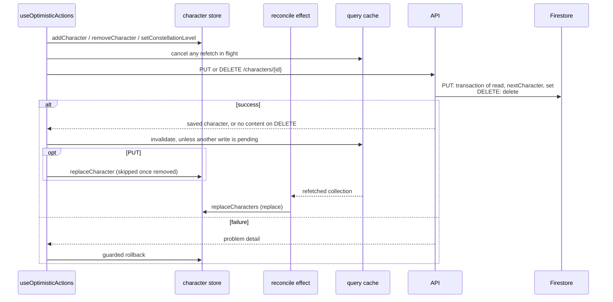
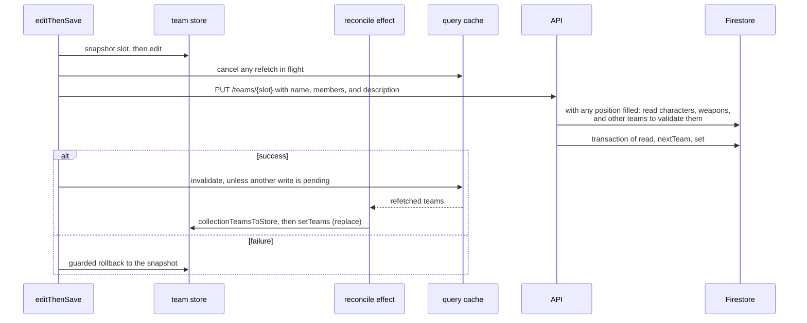
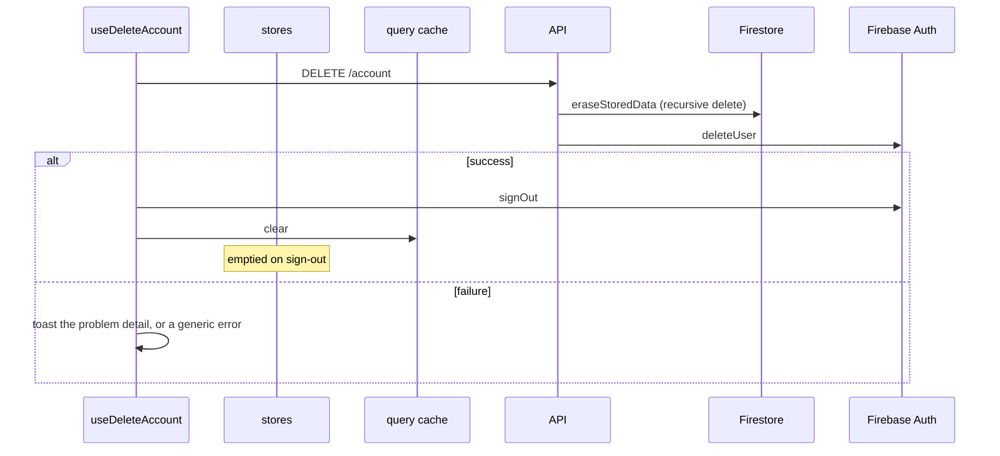

<!-- SPDX-FileCopyrightText: 2026 Alex Brandt <alunduil@gmail.com> -->
<!-- SPDX-License-Identifier: MIT -->

# Write paths

What each client write does to each
[copy of user data](data-flow.md#level-0), in order, on success and on failure.
In the sequence diagrams, an `alt` box runs exactly one of its bracketed
branches, and an `opt` box runs only when its condition holds.

A write path is any code that reaches one of these:

- A non-`GET` route under `apps/api/src/routes/`.
- A zustand `set` call under `apps/web/src/features/`.
- A TanStack Query mutation or cache call.

Four features do: characters, weapons, teams, and the account. Artifact plans
travel inside a team save, so they share the team path.

Each feature's hook is the only caller of its mutations. Characters and teams read from a zustand store, which only the hook writes. The exception is `ClearUserDataOnSignOut`, which empties both stores when a signed-in user signs
out or another account signs in. Weapons have no store and read from the query
cache.

A character or team write skips both client copies: the hook edits the store
and calls the API directly. The server's state comes back the other way,
through a refetch into the query cache and then the hook's own reconcile effect
into the store. Characters also put the saved entry from the mutation response
in the store, unless it was removed meanwhile.

A weapon write goes through its mutation, which edits the cache, calls the API,
and puts the saved instance from the response in the cache. A refetch replaces
the cached collection directly.

Every optimistic write fails the same way, a guarded rollback. The previous
value comes back only if the store or cache still holds the value that write
put there, so a newer edit stands. A toast shows either way, and nothing
retries.

Every mutation follows one refetch rule, set by `useUserQuerySync`. Starting a
write cancels any refetch of its query already in flight. A write that succeeds
while another write to the same query is pending skips its refetch and leaves
it to the write still pending. The cancel skips the first load, and it can't
reach a refetch that starts after the write, such as on window focus or
reconnect. Either can still overwrite a character or weapon edit in flight.
The team store takes no refetch while a team write is pending.

Every write gets its own rollback and toast, even after a later write from the
same hook has started.

A character or weapon write that settles after its sender signs out, or after
another account signs in, changes nothing the next account sees and shows no
toast. `useSenderBoundMutate` drops the hook's handling, and a weapon mutation
writes only into its sender's cache entry. A team save that fails after
sign-out still toasts.

## Characters

`useCollection` in `use-character-collection.ts`. A collection belongs to an
account, so nothing works signed out.

## Weapons

`useWeaponCollection` in `use-weapon-collection.ts`, with its mutations in
`use-weapon-collection-api.ts`. The server mints the instance identifier, so
adding can't be optimistic. Like characters, nothing works signed out.

```mermaid
sequenceDiagram
  participant Hook as useWeaponCollection
  participant Mutation as weapon mutation
  participant Cache as query cache
  participant API as API
  participant FS as Firestore

  alt add or ensure
    Hook->>Mutation: add
    Mutation->>Cache: cancel any refetch in flight
    Mutation->>API: POST /weapons
    API->>FS: create with minted instance ID
    alt success
      API-->>Mutation: saved weapon
      Mutation->>Cache: write the saved instance
      Mutation->>Cache: invalidate, unless another write is pending
    else failure
      Hook->>Hook: toast, cache untouched
    end
  else remove or set refinement
    Hook->>Mutation: remove or set refinement
    Mutation->>Cache: cancel any refetch in flight
    Mutation->>Cache: remove the instance, or set its refinement
    Mutation->>API: DELETE or PATCH /weapons/{instanceId}
    API->>FS: PATCH: read, then set, no transaction<br>DELETE: delete
    alt success
      API-->>Mutation: saved weapon, or no content on DELETE
      opt PATCH
        Mutation->>Cache: write the saved instance
      end
      Mutation->>Cache: invalidate, unless another write is pending
    else failure
      API-->>Mutation: problem detail
      Mutation->>Cache: guarded rollback
      Hook->>Hook: toast naming what the cache shows
    end
  end
```

## Teams

`useTeams` in `use-teams.ts`. Like characters, nothing works signed out.
Signed in, every action goes through `editThenSave`.

On the teams page, a `beforeunload` prompt guards the latest in-flight save.

## Account

`useDeleteAccount` in `use-delete-account.ts`. Nothing is optimistic.

Every document in Firestore lives under `users/{uid}`, so `eraseStoredData`
reaches all of them with one recursive delete. Firestore goes first, so a
failure between the two never orphans data: the identity remains and can retry.

## Divergences

| Question                                   | Characters                             | Weapons                                | Teams                                  |
| ------------------------------------------ | -------------------------------------- | -------------------------------------- | -------------------------------------- |
| Works signed out?                          | No, every action is a no-op            | No, every action is a no-op            | No, every action is a no-op            |
| Optimistic?                                | All three actions                      | Remove and refine, not add             | Every action                           |
| Applies the mutation response to the copy? | Whole entry, skipped once removed      | Whole instance, replaced               | No                                     |
| How a refetch reaches the copy             | Replace                                | Replace, the cache is the copy         | Replace, filled to four slots          |
| Can a refetch overwrite an edit in flight? | Only a refetch the write didn't cancel | Only a refetch the write didn't cancel | Only a refetch the write didn't cancel |
| What a removal elsewhere does to the copy  | Disappears on refetch                  | Disappears on refetch                  | Disappears on refetch                  |

Teams also depend on the other two features. The server rejects a team that
names a character or weapon instance the user doesn't own, so a team save can
fail on a character add still in flight. Removing a character or weapon leaves
the teams that name it unchanged.
