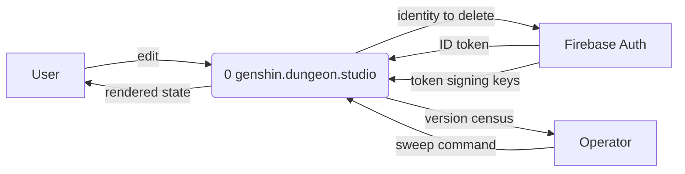
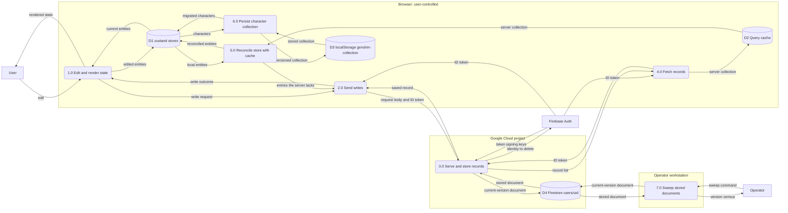

<!-- SPDX-FileCopyrightText: 2026 Alex Brandt <alunduil@gmail.com> -->
<!-- SPDX-License-Identifier: MIT -->

# Data flow

Where each copy of user data lives and which processes move data between them.
User data has up to four copies: the Firestore document, the TanStack Query
cache, a zustand store, and, for characters only, the browser's `localStorage`.
Out of scope: static game data, which is never written, and the theme
preference, which never leaves the browser. Which copy should be authoritative
is [#1133].

Two companion references use this page's store and process numbers:

- [Write paths](data-flow-write-paths.md): what each client write does to each
  copy, in order, on success and on failure.
- [Data conversions](data-flow-conversions.md): the representation data takes
  at each hop between Firestore and the store.

---

## Context

The whole system is process `0`. Firebase Auth and the operator sit outside it
because the system exchanges data with them but doesn't control them.

---

## Level 0

Opening process `0` shows the four copies as data stores. Each labelled box is
a trust boundary:

- The browser runs on hardware the user controls.
- The API and Firestore run in the project's Google Cloud project.
- The sweep runs from an operator's own machine with that operator's
  credentials.

Two signals drive this diagram but carry no data, so they don't appear as
flows:

- A successful mutation invalidates its query, which makes 4.0 refetch. No
  collection or team mutation writes into D2 directly. Account deletion
  empties it.
- An auth change to anything but signed in makes each feature's 5.0 effect empty
  its D1 store.

[#1133]: https://github.com/dungeon-studio/genshin.dungeon.studio/issues/1133
