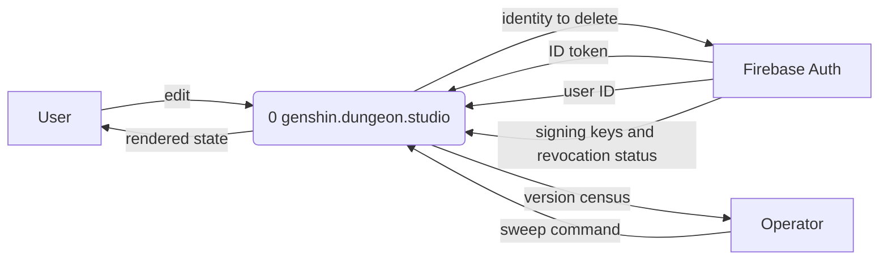
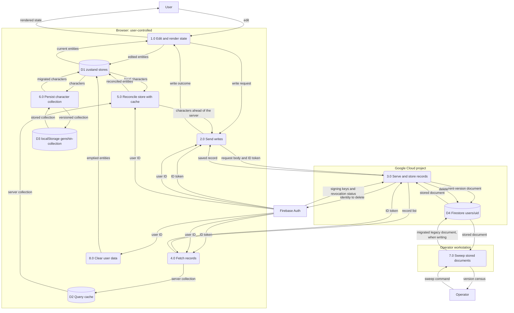

<!-- SPDX-FileCopyrightText: 2026 Alex Brandt <alunduil@gmail.com> -->
<!-- SPDX-License-Identifier: MIT -->

# Data flow

Where each copy of user data lives and which processes move data between them.
User data has up to four copies: the Firestore document, the TanStack Query
cache, a zustand store, and, for characters only, the browser's `localStorage`.
Which copy should be authoritative is [#1133]. Out of scope:

- Static game data, which is never written.
- The theme preference, which never leaves the browser.
- The signed-in session the Firebase Auth SDK keeps in IndexedDB, which
  Firebase owns.

Companion pages:

- [Write paths](data-flow-write-paths.md): what each client write does to each
  copy.
- [Data conversions](data-flow-conversions.md): the representation data takes
  at each hop.
- [Layers](data-flow-layers.md): the browser and API layer stacks, where the
  code skips a layer, and the jobs each layer does.
- [Lifecycles](data-flow-lifecycles.md): the states each entity's store copy
  moves through.

---

## Context

Firebase Auth and the operator exchange data with the system, which doesn't
control them.

---

## Level 0

The system runs eight processes over four data stores, D1 to D4, across three
trust boundaries:

- The browser runs on hardware the user controls.
- The API and Firestore run in the project's Google Cloud project.
- The sweep runs from an operator's own machine with that operator's
  credentials.

A control signal carries no data: a successful collection or team mutation
invalidates its query, which makes Fetch records run again. A mutation that
succeeds while another to the same query is pending skips the invalidation.
Starting a mutation cancels a refetch already in flight. No mutation writes into
the query cache directly. Account deletion empties it. A plain sign-out leaves
the previous user's entries, keyed by user ID, until garbage collection.

Clear user data runs when a signed-in user signs out or another account signs
in, whichever page is open. It empties the character and weapon stores and
resets teams to their default slots. The emptied character collection then
persists to D3.

[#1133]: https://github.com/dungeon-studio/genshin.dungeon.studio/issues/1133
